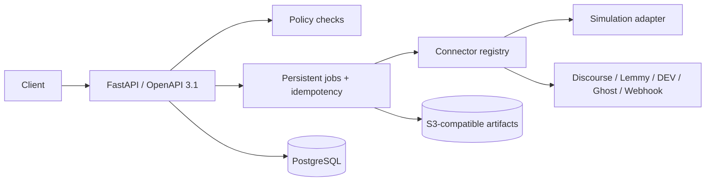

# IncuBrix Distribution Network

A Python connector service for long-tail destinations. It provides a shared connector HTTP contract, destination-level posting rules, idempotent asynchronous publish jobs, certification evidence, and local S3-compatible artifact storage. The local stack is simulation-first: it never publishes to a public platform unless simulation is disabled and a destination has an explicitly configured connection.

The current implementation and evidence roadmap is [the local-only migration plan](docs/LOCAL_ONLY_MIGRATION_PLAN.md).

## Architecture



The connector methods are `validate`, `publish`, `get_status`, and `delete`; the assisted connector exposes `build_assist_pack`. Method routes use `/connector/v1/{connector_key}/{method}`. The management API is under `/api/v1/`; health routes are `/health` and `/ready` as required by the integration standard.

## Start locally

Requirements: Docker Desktop with Compose v2. `docker compose up` builds and starts the API, PostgreSQL, a Moto S3-compatible test endpoint, and local Lemmy and Ghost services. Lemmy and Ghost first-run account setup is manual; no real account or API key is needed for simulation mode.

```powershell
docker compose up
```

Open API docs at [http://localhost:8000/docs](http://localhost:8000/docs), Lemmy at [http://localhost:8536](http://localhost:8536), and Ghost at [http://localhost:2368/ghost](http://localhost:2368/ghost). The local S3-compatible endpoint is [http://localhost:5000](http://localhost:5000). These services are local test dependencies, not public destinations.

Run the suite in one command:

```powershell
docker compose --profile tools run --build --rm test
```

For local Python development, create a virtual environment, install `requirements.lock` and `requirements-test.lock`, then run `python -m pytest`. The lock file skips the optional `uvloop` package on Windows, where it is unsupported.

## Quick API path

Every POST requires an `Idempotency-Key` header. The connector publish method also accepts the contract's `idempotency_key` body field.

1. `POST /api/v1/destinations` with a destination record and a rules object.
2. `POST /api/v1/publishes` with `destination_id` and `rendition`; the response is `202` with a `job_id`.
3. Poll `GET /api/v1/jobs/{job_id}` until `succeeded` or `failed`.
4. For a local or approved sandbox destination only, start certification with `POST /api/v1/destinations/{id}/certifications` and poll its job. Evidence is saved as a JSON artifact; failed runs and cleanup outcomes are retained.

Optional completion callbacks can be supplied as `callback_url` in a publish or certification request. They are disabled unless the operator configures both `CALLBACK_ALLOWED_HOSTS` and `JOB_CALLBACK_SIGNING_SECRET`. The service POSTs a terminal `job.completed` event to an exact allowlisted host with `X-IncuBrix-Signature-256: sha256=<hex>`, calculated over the exact JSON request body. Redirects are rejected; callback delivery never changes the terminal job state, so clients must retain normal job polling.

Example destination request:

```json
{
  "name": "Local Discourse",
  "url": "http://discourse",
  "platform_key": "discourse",
  "surface": "topic",
  "category": "developer",
  "audience_tags": ["AI", "video"],
  "connector_key": "discourse",
  "rules": {
    "frequency_cap": {"max_posts": 1, "window_seconds": 604800},
    "self_promo_allowed": false,
    "link_policy": "review_required",
    "disclosure_required": true,
    "automation_allowed": true,
    "content_types": ["text"],
    "spec": {"title_max_chars": 255, "body_max_chars": 32000, "links_allowed": true}
  },
  "connection": {"base_url": "http://discourse", "api_key_env": "DISCOURSE_API_KEY", "api_username": "system"}
}
```

Connection secrets are environment variable references only. The service resolves them at run time; it rejects inline values such as API keys and tokens and does not return stored connection data.

## Import a small destination catalogue

`POST /api/v1/catalogue/import` accepts a UTF-8 CSV file and requires an `Idempotency-Key` header. The required columns are `name,url,platform_key,surface,category,connector_key`; optional columns are `audience_tags,language,geo,est_audience,rules_url,level`. Separate audience tags with `|`. The endpoint accepts at most 4 MiB and 1,000 rows, rejects unknown columns and invalid rows atomically, and reports every invalid row it found. It skips destinations already present with the same platform and normalized URL (case, default port, trailing slash, and fragment do not create a second instance). CSV imports cannot set connections or credentials; imported rows use the safe destination defaults. Reusing a key with the same file replays the original result, while using that key with different file contents returns `IDEMPOTENCY_CONFLICT`.

```powershell
curl.exe -X POST http://localhost:8000/api/v1/catalogue/import `
  -H "Idempotency-Key: catalogue-demo-001" `
  -F "file=@testpack/catalogue/destinations.csv"
```

The sample contains fictional `.example` destinations. See [destinations.csv](testpack/catalogue/destinations.csv).

## Supported connector keys

| Key | Contract / mode | Current implementation notes |
|---|---|---|
| `discourse` | Native | API key, topic creation, status, deletion |
| `lemmy` | Native | JWT, post creation, status, removal |
| `devto` | Native | Forem API create/read/unpublish; its unpublish route may require admin/moderator permissions |
| `ghost` | Native | Ghost Admin API JWT and post create/read/delete |
| `signed-webhook` | Protocol | HMAC-SHA256 signed publish/status/delete endpoint templates |
| `assisted` | Assisted | Builds files/caption/deep-link/checklist; never posts automatically |
| `mastodon` | Extra native | OAuth access token, status create/read/delete |
| `discord-webhook` | Extra bridge | Environment-held webhook URL, message create/read/delete |
| `matrix` | Extra bridge | Access token, room message create/read/redact |
| `slack` | Allowed-list extra | Bot token, channel message, permalink lookup, bot-owned deletion; needs `chat:write` and channel access |
| `hashnode` | Allowed-list extra | GraphQL publish/read/soft-remove; mutations need a Personal Access Token and the publication must have an active Pro plan |
| `peertube` | Allowed-list extra | Imports a video from an approved source URL, polls processing, reads status and deletes the owned video; requires explicit source-host allowlisting |

Connection examples use environment references: Slack `{"bot_token_env":"SLACK_BOT_TOKEN","channel_id":"C01234567"}`, Hashnode `{"personal_access_token_env":"HASHNODE_PERSONAL_ACCESS_TOKEN","publication_id":"<publication-id>"}`, and PeerTube `{"access_token_env":"PEERTUBE_ACCESS_TOKEN","base_url":"https://tube.example","channel_id":"7"}`. For PeerTube, set `MEDIA_IMPORT_ALLOWED_HOSTS` to the exact approved source domains. Do not allow arbitrary video URLs: the PeerTube server downloads that URL.

`POST /api/v1/recommendations` ranks enabled destinations from declared audience tags and language. When a `rendition` is supplied it excludes destinations that violate their known rules, and uses prior feedback acceptance as a bounded ranking adjustment. `POST /api/v1/recommendations/{idempotency_key}/feedback` accepts decisions only for destinations from that recommendation response, and `GET /api/v1/recommendations/metrics` reports accepted recommendations divided by reviewed recommendations. `POST /api/v1/tailor` applies destination length and disclosure constraints. These helpers are deterministic and always require human review before publishing.

The simulation adapter is available for all native/protocol connectors and deterministic tests. With `SIMULATION_MODE=false`, configure each connector's destination and required credential environment variables. Certification is blocked for hosts outside `CERTIFICATION_ALLOWED_HOSTS`. Keep it restricted to localhost and the local containers unless the destination owner has explicitly agreed to a sandbox.

The 150-record global English discovery catalogue is in [researched-global-english.csv](testpack/catalogue/researched-global-english.csv). Read the [catalogue research limits](testpack/catalogue/README.md) and matching provenance file before importing it. Directory listing does not prove reachability, posting permission, or live certification.

## Files, evidence, and rights

`POST /api/v1/artifacts` accepts exactly one multipart `file` or public HTTP(S) `source_url`, with an optional declared license name and URL. It blocks private and link-local URL targets, rejects redirects, caps artifacts at 25 MiB, records a SHA-256 digest, and writes the file plus a JSON rights manifest to S3-compatible storage. A license declaration is recorded as supplied; the application does not independently verify it. Only use media/content you own or have commercially licensed.

Artifacts, manifests, and certification evidence are stored in the local Moto S3-compatible service configured by Docker Compose.

## Configuration

All configuration comes from environment variables; `.env.example` lists local settings. Copy it to `.env` only if you need to override defaults. Do not commit `.env`. Important settings:

- `APP_ENV`: use `development` or `test` only for local use. The process defaults to a fail-closed `production` posture when this is omitted.
- `APP_API_KEY`: required (24+ characters) in production. Send it as `X-API-Key` or `Authorization: Bearer …`; health/readiness remain public for probes.
- `TRUSTED_HOSTS`: comma-separated Host header allowlist. Set the public hostname before placing the API behind a proxy or load balancer.
- `CONNECTOR_CONTRACT_ENABLED`, `ARTIFACT_SOURCE_FETCH_ENABLED`: direct connector calls and remote URL artifact fetching are enabled by default only for development/test. Production must opt in deliberately after API authentication and egress controls are configured.
- `OUTBOUND_ALLOWED_HOSTS`: explicit private-host allowlist for live local/sandbox connectors. Public connector targets are DNS-checked; production network egress controls should enforce the same boundary to guard against DNS rebinding.
- `CALLBACK_ALLOWED_HOSTS`, `JOB_CALLBACK_SIGNING_SECRET`: enable optional HMAC-signed terminal job callbacks. Configure them together, use exact callback hosts, and verify the SHA-256 signature against the raw request body.
- `CONNECTOR_ALLOWED_HOSTS`: mandatory when `SIMULATION_MODE=false`; it is an exact hostname allowlist for every live connector request. This prevents a destination configuration from redirecting an environment-backed platform credential to an arbitrary host.
- `JOB_LEASE_SECONDS`: worker lease duration. Non-publish jobs with expired leases are reclaimable. A publish with an expired lease is blocked for reconciliation so an unknown remote outcome cannot create a duplicate.
- `RECERTIFICATION_MAX_AGE_DAYS`: maximum live certification age. The worker demotes expired L3/L4 destinations, blocks publishing, and opens a local recertification ticket.
- `RECERTIFICATION_RETEST_LEAD_DAYS`: schedule one certification test this many days before expiry (default 2). The scheduler runs only when `SIMULATION_MODE=false` and the destination host is approved. A simulated run cannot extend the live certification date.
- `RULE_PAGE_FETCH_ENABLED`: permit rule proposals from a fetched HTML or text page. The page host must also appear exactly in `OUTBOUND_ALLOWED_HOSTS`; redirects are rejected, the response is limited to 1 MiB, and a person must confirm the proposal.
- `DATABASE_URL`: PostgreSQL in Compose; SQLite can be used for local development only.
- `SIMULATION_MODE`: `true` by default. Set `false` only when ready to call configured local/sandbox APIs.
- `S3_ENDPOINT_URL`, `S3_PUBLIC_ENDPOINT_URL`: required local Moto endpoints for service-to-service calls and browser downloads respectively.
- `S3_BUCKET`: local artifact bucket.
- `CERTIFICATION_ALLOWED_HOSTS`: comma-separated host allowlist for certification posts.
- `*_API_KEY`, `LEMMY_JWT`, `GHOST_ADMIN_API_KEY`, `PARTNER_WEBHOOK_SECRET`, `MASTODON_ACCESS_TOKEN`, `DISCORD_WEBHOOK_URL`, and `MATRIX_ACCESS_TOKEN`: secret values; use secret storage/environment in deployment.

The Compose ports are intentionally bound to `127.0.0.1` for the local assessment stack. Put a production deployment behind an authenticated TLS reverse proxy, set `APP_ENV=production`, configure `TRUSTED_HOSTS`, and provide `APP_API_KEY`; do not expose the development Compose defaults directly to a network.

## Error codes

API errors use `{ "error": { "code", "message", "retryable", "details" } }`.

| Code | Meaning |
|---|---|
| `DEST_SPEC_VIOLATION` | Content or request breaks format/policy rules |
| `DEST_RULE_FREQUENCY_CAP` | Posting cap reached; retry after the indicated time |
| `CONNECTION_AUTH_EXPIRED` | Missing/expired/revoked connection credentials |
| `PLATFORM_RATE_LIMIT` | Platform returned 429; job backs off using reset information |
| `PLATFORM_QUOTA_EXHAUSTED` | Platform quota used up |
| `PLATFORM_CONTENT_REJECTED` | Platform rejected content |
| `PLATFORM_UNAVAILABLE` | Platform unavailable; retryable failures stop after five attempts |
| `CONNECTOR_DISABLED` | Connector or destination is disabled/assisted-only |
| `IDEMPOTENCY_CONFLICT` | Reused idempotency key has a different request body |
| `DESTINATION_NOT_FOUND` | Destination or job resource was not found |
| `INTERNAL_ERROR` | Unexpected sanitized service error |

## Batch runner

`python -m incubrix.batch_runner INPUT_FILE_OR_DIRECTORY OUTPUT_DIRECTORY --base-url http://localhost:8000` runs connector, publish, and certification cases, saves each request and response (including expected and unexpected failures), and writes an `index.json` with outcomes and error codes. Pass `--run-id review-2026-11-23` to give this run a fresh, repeatable idempotency namespace. Certification cases create a destination, poll the run, and retain the final certification record. Evidence redacts credential fields and echoed secret values. Example cases live in `testpack/cases/`.

Run `python scripts/capture_local_evidence.py` to reproduce the local test and Compose configuration evidence in `evidence/local/`. It records command outputs and hashes without contacting external platforms.

## Current limits to verify before making claims

- Local Lemmy and Ghost containers start from Compose; initial administrator/account setup and platform API keys must be created manually for non-simulation certification. Their local publish/status/delete adapter cycles have been verified; run evidence is in the ignored local directory `evidence/phase3/`.
- The `assisted` connector intentionally returns `needs_review`; it does not pretend that a human has published or deleted a post.
- The application is local-only. It does not deploy an external API or create a public demo endpoint.
- Rule proposals, recommendations, and tailoring use deterministic local rules and require human review. They do not represent an external AI provider or researched destination catalogue. CSV catalogue import validates source-supplied rows; it does not research or certify destinations.
- Discourse and DEV.to have passed the repository's local mock lifecycle checks, not live platform certification. DEV.to live verification needs an authorized API key, and Discourse needs an owned or approved instance.

See `docs/ASSESSMENT_EXECUTION_PHASES.md` and `docs/LOCAL_ONLY_MIGRATION_PLAN.md` for requirement gates and remaining evidence.
